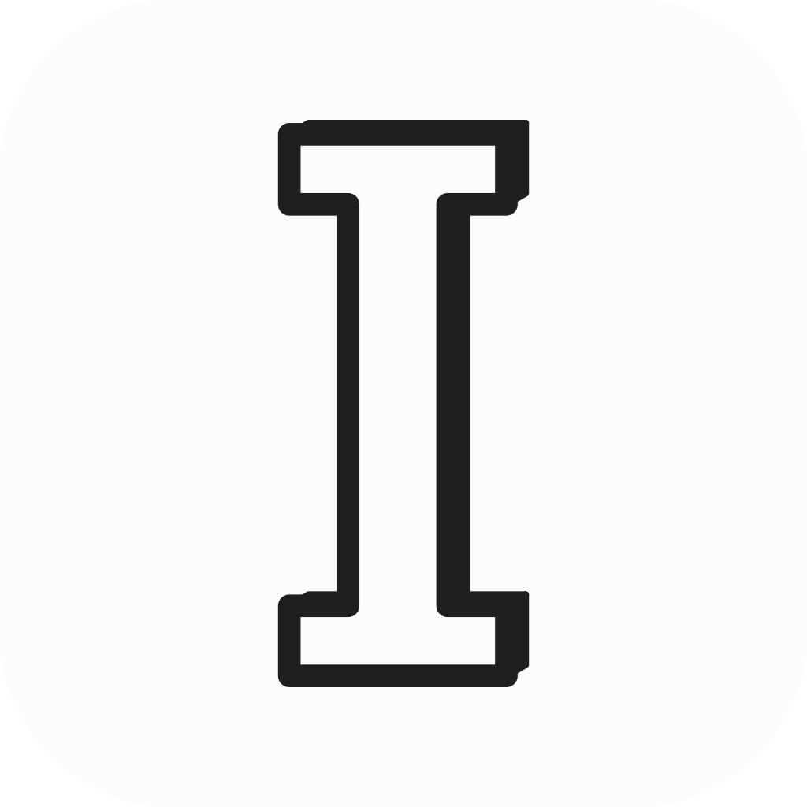

<p align="center">
  
</p>

<h1 align="center">Intcad</h1>

<p align="center">
  <strong>An open-source parametric 3D CAD application built in pure Rust.</strong><br />
  Sketch, constrain, and build solids with a parametric feature timeline. Change a dimension
  and watch your model rebuild. Run it on your desktop, in your browser, or let AI agents
  model through the built-in MCP server.
</p>

<p align="center">
  An <a href="https://github.com/intgral-ai">Intgral</a> fork of
  <a href="https://github.com/tangency-labs/solidcraft">SolidCraft</a>.
</p>

## Download

This fork does not publish hosted installers yet. Build it from source with the commands
below. The upstream SolidCraft project publishes its own packages at
[solidcraft.io](https://solidcraft.io); those are not this fork.

## What works

Early but usable for simple parts: 75 of 76 public reference parts match their analytic or
FreeCAD-computed volume, area, centre of mass and bounding box ([oracle](docs/oracle.md)); the
other is a tracked bug.

- **Sketches and constraints:** lines, arcs, splines, text and more, solved by our own constraint solver, with parameter-driven dimensions.
- **Features:** extrude, revolve, sweep, loft, fillet, chamfer, shell, draft, holes, threads, patterns, mirror, split and combine on an editable parametric timeline.
- **Parameters and configurations** with unit-aware expressions.
- **Assemblies** with joints, motion studies, contact sets, interference and mass properties.
- **Sheet metal** with flanges, hems, fold/unfold and flat patterns, and plastic enclosure features.
- **Files:** STEP, IGES, 3MF, STL, OBJ and glTF in and out where supported, URDF export, `.sc` designs (`.solidcraft` files from earlier releases still open).
- **Desktop app, browser app, headless CLI and MCP server**, all running the same commands.

The full list is in [docs/capabilities.md](docs/capabilities.md) and [docs/features.md](docs/features.md);
status and plans are in [ROADMAP.md](ROADMAP.md). See also [what people built](docs/showcase.md),
[3D mouse support](docs/3d-mouse.md) and the [architecture](docs/architecture.md).

## Build from source

```sh
cargo run --release -p solidcraft -- --sample      # desktop app with a sample part
cargo run --release -p solidcraft-cli -- commands  # the command registry
cargo run --release -p solidcraft-cli -- run examples/bracket.json --out bracket.step
cargo xtask ci                                     # fmt, clippy, tests, icons, assets, layers, wasm
```

More commands, the Windows cross-build and the browser build are in [docs/building.md](docs/building.md).

## AI agents (MCP)

`solidcraft-cli mcp` is a [Model Context Protocol](https://modelcontextprotocol.io) server. Headless it
runs its own design session, or with `--connect` it drives the running app so you can watch.
Claude Code: `claude mcp add solidcraft -- solidcraft-cli mcp`. If a terminal doesn't find
`solidcraft-cli` (older Windows installers don't put it on `PATH`), give its full path (by default
`"C:\\Program Files\\SolidCraft\\solidcraft-cli.exe"`). Tools, access rules and an example session:
[docs/mcp.md](docs/mcp.md).

## Scripts

A script is a JSON list of the same commands the UI runs, executed with `solidcraft-cli run`.
Format and example: [docs/scripts.md](docs/scripts.md). Pages can also be driven through the
[browser command API](docs/browser-api.md).

## Contributing

Help is welcome. [CONTRIBUTING.md](CONTRIBUTING.md) covers how to build and test, the code map,
the clean-room and licence rules, and where help is wanted most. Open work is in
[GitHub issues](https://github.com/intgral-ai/open-skyfall-desktop/issues).

## Upstream, compatibility and licence

`Intcad` is maintained by Intgral. It is a fork of
[SolidCraft](https://github.com/tangency-labs/solidcraft), and the upstream project keeps its
own name, logo, website and releases.

The product name in the interface is `Intcad`. Internal identifiers still use
`solidcraft` so existing designs, scripts, packages and settings keep working: crate and binary
names (`solidcraft`, `solidcraft-cli`), the `.sc` design format and its `solidcraft/N` tag,
`SOLIDCRAFT_*` environment variables, settings folders, app IDs and the MCP server name.
The compatibility record is in [docs/compatibility.md](docs/compatibility.md).

The code is MIT OR Apache-2.0, at your option. The Intgral name and marks are brand assets and
are not covered by that licence. Developed under the [clean-room contribution rules](AGENTS.md);
third-party code and assets retain their documented licences and attribution. The upstream
SolidCraft copyright and licence notices remain in [NOTICE](NOTICE), [LICENSE-MIT](LICENSE-MIT)
and [LICENSE-APACHE](LICENSE-APACHE).

The files in this repository are provided as is, without warranty, liability or indemnity:
read [DISCLAIMER.md](DISCLAIMER.md).

SolidCraft and Intcad are independent of CAD vendors. Behaviour is designed from public
documentation, general CAD conventions and user feedback. Reference tests use analytic values
and open-source tools. Neither project is affiliated with, sponsored by or endorsed by Autodesk,
Dassault Systèmes, PTC, Siemens or any other CAD vendor. Fusion, AutoCAD, Inventor, SolidWorks,
Onshape, Creo, Blender and Tinkercad are trademarks of their respective owners, named only to
describe compatibility (see [NOTICE](NOTICE)).
